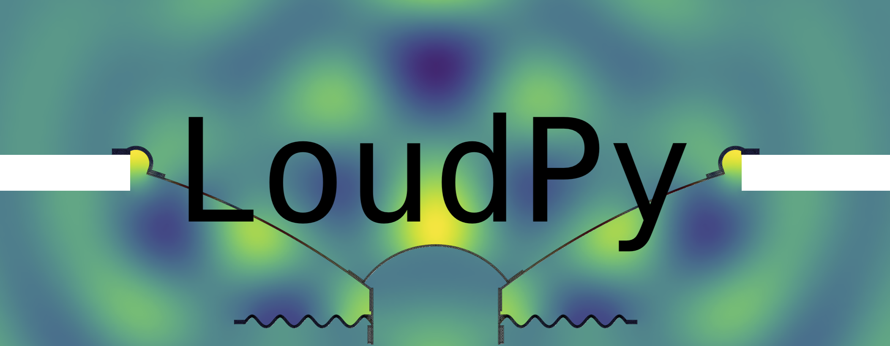

# LoudPy 0.2 (beta)

LoudPy is an open-source Python API dedicated to loudspeaker finite element simulation, released under the [GPL-3.0 license](https://www.gnu.org/licenses/gpl-3.0.html).

> ⚠️ **Beta version** — The API is still under active development. Documentation: `docs/` (Sphinx, see [Documentation](#documentation)).
## Overview

Designing a loudspeaker with FEM means choosing between complex general-purpose tools that
require deep expertise, or expensive commercial software. LoudPy is a free, Python-based
alternative built specifically for loudspeaker/transducer engineers and researchers.

Starting from a CAD file of your loudspeaker, LoudPy lets you:
- run **harmonic frequency-domain simulations** (structural, acoustic, or fully coupled FSI)
- extract **eigenfrequencies** and mode shapes of the mechanical structure
- simulate **nonlinear behaviour** 
- evaluate results at points, arcs and lines, plot them as consistent scientific figures, and
  export them (NumPy, pandas, CSV, MATLAB, ParaView)

The finite element formulations are entirely custom — this project does not depend on any 
external FEM library. Numerical computations rely exclusively on **NumPy**, **SciPy**, and 
**Numba**, while meshing is handled by **Gmsh**.

This project was developed by Romain Degraeve as part of the
[IMDEA Master's programme in Acoustics](https://iags.univ-lemans.fr/en/education-programs/master-s-degrees-in-acoustics/parcours-en-anglais/imdea.html#Generalinformation1-1)
(International Master Degree in Acoustics).

## Installation

The easiest way to install LoudPy is via pip:

```bash
pip install "loudpy[all]"        # with plotting (matplotlib, pandas) and 3D views (pyvista)
```

The core (`pip install loudpy`: NumPy, SciPy, Numba, h5py, gmsh) runs every study; the extras add
`loudpy[plot]` and `loudpy[3d]`.

For development installation, see the [Developer Setup](#developer-setup) section below.

## Quick start

```python
import numpy as np
import loudpy as lp

model = lp.Model("LoudPy_exemples/Geometries/Loudspeaker/HPNEW-Sketch.geo")
model.add(lp.Solid("membranne", "Paper"), lp.Solid("coil", "Copper"), lp.Solid("surround", "Rubber"),
          lp.Solid("spider", "PhenolicCloth"), lp.Solid("former", "Kapton"), lp.Solid("glue", "SolidGlue"),
          lp.Solid("dustcap", "Polypropylene"),
          lp.Clamped("interface_constrained_rz"), lp.Clamped("interface_constrained_r", dofs="r"),
          lp.Coil("interface_forced"))
print(model)                                          # the model tree; model.check() before meshing
model.mesh("mesh.msh")

lp.set_verbosity("info")                              # progress messages (silent by default)
modes = lp.Modes(model).solve(f_max=20000)            # eigenmodes
modes.table()                                         # f, ζ (pandas)
modes.mode(0).plot(deformed=True)                     # the first mode shape

res = lp.FrequencyResponse(model, drive=lp.Force(1.0)).solve(np.geomspace(20, 20000, 200))
u = res.displacement(at=(0.0, 0.0), component="z")    # labelled data: u_z over f, with units
u.plot()                                              # scientific figure, labels from the quantity
u.export("cone_tip.csv")                              # for Excel / MATLAB / Origin (or .mat, .npz)
np.asarray(u)                                         # plain NumPy for your own post-processing
```

A model (or a 3D `lp.Scene`) goes into a study (`Modes`, `FrequencyResponse`, `Transient`); the
study returns results, saved with `study.save(path)` and read back with `lp.load(path)`. Evaluating
results (`res.spl(at=…)`, `res.field("p", f=…)`, at points, `lp.Arc`s or `lp.Line`s) gives labelled
data (`lp.Data`, `lp.Field`) that plot themselves and export to NumPy, pandas, CSV, MATLAB and
ParaView.

## Examples

The `LoudPy_exemples/` folder contains ready-to-run scripts (run them from the repository root).
Each example has a `Running_*.py` (writes `Results/Files/`) and `Loading_*.py` / `Plot_*.py`
scripts (write `Results/Figures/`).

| Example | Description |
|---|---|
| `Eigen_study/Meca` | Structural modes of the driver in vacuo |
| `Eigen_study/Fourier` | Azimuthal-order (non-axisymmetric) modes, 3D views, plate validation |
| `Eigen_study/FSI_DtN` | Coupled structure + air modes with an exact radiation condition |
| `Frequency_study/Meca` | Mechanical-only frequency sweep |
| `Frequency_study/FSI` | Coupled structural–acoustic sweep, air remeshed per wavelength |
| `Frequency_study/FSI_elec` | The same, voltage-driven (impedance, coil current) |
| `Time_study/Multitone` | Nonlinear time-domain simulation, multi-tone |
| `Sweep_study` | Parametric sweeps: geometry (plate radius × thickness) and materials (suspension stiffness) |
| `Coupling_3D/Driver_in_cavity` | Driver in a 3D enclosure: cavity modes, radiation on a rigid ground, vented box, elastic MDF walls |
| `Coupling_3D/Labyrinth` | Folded transmission line on a rigid ground |
| `Coupling_3D/Column_labyrinth` | Three drivers in a column with a folded line (multi-driver) |

## Documentation

```bash
pip install sphinx furo
python3 -m sphinx -b html docs docs/_build/html      # then open docs/_build/html/index.html
```

## Publication

LoudPy will be presented at Acousticum 2026 — (ref. 226).

## Contributing

If you want to contribute to this open-source project, feel free to reach out:

- Email: [rom2graeve@gmail.com](mailto:rom2graeve@gmail.com)
- LinkedIn: [Romain Degraeve](https://www.linkedin.com/in/romain-degraeve-558073290/)

---

## Technical Details

### Workflow

geometry → selections → materials and physics → mesh → studies → results, as in COMSOL / ANSYS:

1. **Geometry** — a `.geo` file (curve loops or physical surfaces), a CAD file (STEP / IGES / BREP, a 2D
   sketch whose closed regions become domains) or a Python builder function; 3D cabinets are builder functions
   (`lp.Scene`).
2. **Selections** — names are labels only: `lp.Group`, `lp.Box`, `lp.Near`, `lp.Interface`, `lp.BoundaryOf`, combined
   with `|`, `&`, `-` (`lp.plot.selection` shows what they select).
3. **Model items** — `lp.Solid`, `lp.Air`, `lp.PML`, `lp.Clamped`, `lp.Coil`, `lp.FluidStructure`, `lp.Radiation`,
   `lp.MeshSize`; `print(model)` shows the model tree, `model.check()` checks it before meshing; values may be
   parameters (`lp.Parameters`, `lp.P("h")`).
4. **Mesh** — gmsh, deterministic, reused while its signature (geometry, items, sizes, parameters) is unchanged;
   element order 1–3, triangles or quadrangles.
5. **Studies** — `lp.Modes`, `lp.FrequencyResponse`, `lp.Transient`; `lp.Sweep` (parametric), `lp.Adaptive`
   (adapted meshes), `lp.convergence` (mesh convergence).
6. **Results** — a self-contained HDF5 file (loudpy result format 3: fields, meshes, the model description and
   geometry files, the study settings), read back with `lp.load`.

### Studies

| Study | Description |
|---|---|
| `lp.Modes(model)` | Structural modes (axisymmetric, or azimuthal orders m = 0, 1, 2…), complex with damping |
| `lp.Modes(model, physics="coupled")` | Coupled structure + air modes with an exact (DtN) radiation condition |
| `lp.Modes(model, physics="acoustic")` | Acoustic modes of the air (rigid structure) |
| `lp.FrequencyResponse(model, drive=…)` | Harmonic response: structure, or structure + air (force or voltage drive with the voice-coil circuit), air remeshed per wavelength |
| `lp.Transient(model, drive=lp.Force(signal, fs))` | Geometrically nonlinear time response |
| `lp.Modes / lp.FrequencyResponse(scene)` | 3D enclosures with one or several drivers: cavity modes, exterior air on a rigid ground (exact DtN), one merged air domain (vented boxes, lines), elastic walls (shells) |
| `lp.Sweep(study, {name: values, …}, combine="grid" \| "zip")` | Parametric study over any parameters (item values, builder or `.geo` geometry), 2D models and 3D scenes; results as labelled data over the parameters; one result file |
| `lp.Adaptive(study, target=…)`, `lp.convergence(study, factors=…)` | Meshes adapted to the error estimate; convergence tables with observed orders |

### Physics

- **Structure** — axisymmetric linear elasticity (Lagrange P1–P3 triangles, Q1–Q2 quadrangles, curved cells),
  azimuthal Fourier orders, total-Lagrangian nonlinearity; shells (MITC3 / MITC4) for 3D cabinet walls
- **Air** — pressure Helmholtz equation (2D axisymmetric and 3D P2 tetrahedra), air from temperature, pressure and
  humidity (`lp.air`)
- **Coupling** — `lp.FluidStructure` boundaries, normals from the mesh; voice coil as a force or a voltage drive
  (Re, Le, semi-inductance, Bl)
- **Damping** — Rayleigh (`α`, `β`, every study) and hysteretic (`η`, frequency domain), per region
- **Radiation** — `lp.PML`, or exact Dirichlet-to-Neumann conditions (2D sphere, 3D half-space)

### Material Library

`materials.json` (typical values, unverified): `Polypropylene`, `Paper`, `Copper`, `Rubber`, `Kapton`,
`PhenolicCloth`, `SolidGlue`, `MDF`, `Plywood`, `Aluminium`, `Steel`, `Air`; or `lp.Material(...)` in a script.

### Post-processing

- `res.spl(at=…)`, `res.pressure(at=…)`, `res.displacement(at=…, component="z")`, `res.probe(name, at=…)` at points,
  `lp.Points`, `lp.Arc`, `lp.Line` → `lp.Data` (values with coordinates and units); `res.far_field(...)`
- `res.field(name, f=…)` → `lp.Field` (values on the mesh), also derived fields: strain, stress, von Mises, velocity,
  particle velocity, intensity
- Derived values: volume velocity, radiated power, Thiele–Small parameters
- `.plot()` and `lp.plot` (mode grids, directivity, 3D views, animations, selections), one scientific style;
  `lp.plot.html(field, "x.html")`: interactive viewer in one HTML file
- `.to_pandas()`, `np.asarray(…)`, `.export("x.csv" | "x.mat" | "x.npz" | "x.vtu" | "x.html")`, `res.export("x.pvd")`
  (ParaView series), `res.export("x.vtkhdf")` (one-file series), `data.export("x.nc")` (netCDF, read back with
  `lp.load_data`), `lp.read_comsol` / `lp.compare` for comparisons with COMSOL exports

### Verification

`pytest --slow` (≈ 380 tests: manufactured solutions, analytical benchmarks, regression references, plots); the
numbers measured by the verification tests are in `docs/guide/verification_report.rst`.

---

## Developer Setup

LoudPy uses [PDM](https://pdm-project.org) for package management.

**Install PDM via pipx** (recommended — keeps PDM isolated):
```bash
pipx install pdm
```

**Or via uv:**
```bash
uv pip install pdm
```

**Verify:**
```bash
pdm --version
```

**Install LoudPy in editable mode:**
```bash
pdm install -e .
```

LoudPy is developed under Python 3.13. To install it with uv:
```bash
uv python install 3.13
```
